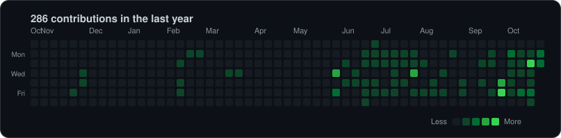

 

 

## 👋 About me

- 🔭 Working on a **SaaS CRM** platform
- 🌱 Learning **cloud architecture on AWS**
- 🧩 I like multi-service backends: Django for the core, FastAPI/Flask/Go services around it, Redis for real-time

 

## 🧰 Tech stack

**Cloud & DevOps** 

**Backend** 

**Frontend** 

**Data** 

 

## 📊 Activity (private repos included)

 

